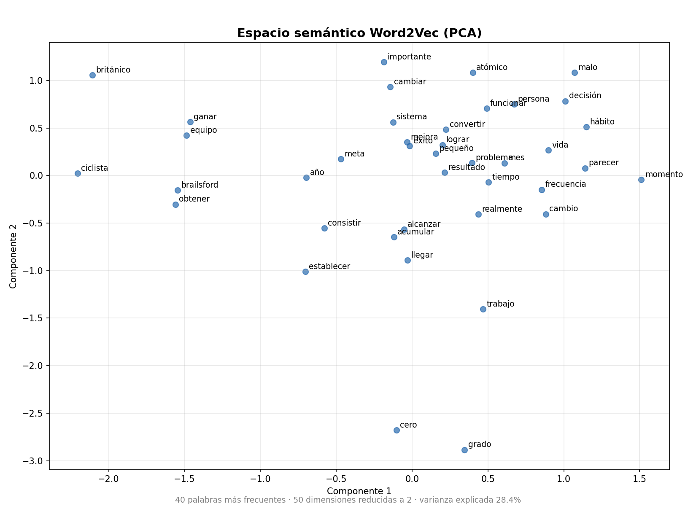
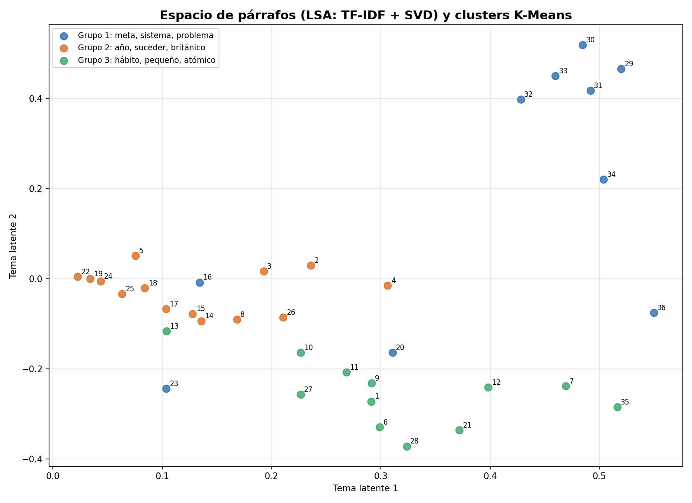

# Limpieza y vectorización de texto — Hábitos atómicos (Cap. 1)

Proyecto de Procesamiento de Datos sobre un libro en español:
**Carga de datos → Limpieza → Vectorizaciones → Semántica distribucional**.

## Contenido
- `habitos_atomicos_cap1.txt` — texto a procesar (fragmento: Capítulo 1 de *Hábitos atómicos*, James Clear, usado con fines educativos).
- `limpieza.py` — proceso de limpieza: ingesta, pre-limpieza del PDF, normalización, eliminación de stopwords y lematización.
- `requirements.txt` — dependencias congeladas con `pip freeze`.
- `habitos_atomicos_limpio.txt` — resultado generado.
- `main.py` — ejecuta todo el proyecto en orden.
- `vectorizacion.py` — técnicas de vectorización sobre el texto limpio (checkpoint 3).
- `semantica_distribucional.py` — vectorización con semántica distribucional y gráficas (proyecto final).
- `imagenes/` — representaciones gráficas de los espacios vectoriales (`.png`).
- `resultados/` — matrices BoW, TF-IDF, similitud coseno, modelo Word2Vec y salida de consola.

## Proceso
1. **Ingesta:** lectura del `.txt` en UTF-8.
2. **Pre-limpieza:** normalización Unicode (NFC), eliminación de encabezados y números de página, unión de palabras cortadas con guion.
3. **Normalización:** minúsculas, eliminación de URLs, correos, números, puntuación y espacios extra.
4. **Lematización:** tokenización con `es_core_news_sm`, eliminación de stopwords y tokens cortos, reducción a lema.

5. **Ajustes:** lemas que son stopwords ("se" → "él") y verbos con pronombre ("convertirse" → "convertir").

## Vectorización (checkpoint 3)
Cada párrafo del capítulo se trata como un documento (36 en total).

| Técnica | Herramienta | Qué representa |
|---|---|---|
| Bag of Words | `CountVectorizer` | Cuántas veces aparece cada palabra en cada párrafo |
| One-Hot / binario | `CountVectorizer(binary=True)` | Si la palabra aparece o no |
| TF-IDF | `TfidfVectorizer` | Frecuencia ponderada: pesa más lo frecuente en un párrafo pero raro en el resto |
| N-gramas | `TfidfVectorizer(ngram_range=(1, 2))` | Pares de palabras como "hábito atómico" |
| Word2Vec | `gensim` | Vector denso de 50 dimensiones por palabra, aprendido por contexto |
| Similitud coseno | `cosine_similarity` | Qué tan parecidos son dos párrafos según TF-IDF |

## Semántica distribucional (proyecto final)
Hipótesis distribucional: *palabras que aparecen en contextos similares tienen significados similares*.

- **Basado en conteo:** matriz de co-ocurrencia (ventana ±4) → **PPMI** (qué pares aparecen juntos más de lo esperado por azar) → **SVD** a 50 dimensiones.
- **Basado en predicción:** **Word2Vec** skip-gram, 50 dimensiones.
- Se comparan los vecinos semánticos de ambos enfoques (ej. con PPMI, *hábito* queda cerca de *malo*, *enemigo* y *aliado*).

| Imagen | Qué muestra |
|---|---|
| `01_word2vec_pca.png` | Espacio de palabras Word2Vec reducido con PCA |
| `02_ppmi_svd.png` | Espacio de palabras por conteo (PPMI + SVD) |
| `03_word2vec_tsne.png` | Vecindarios semánticos de Word2Vec con t-SNE |
| `04_parrafos_lsa.png` | Párrafos en el espacio de temas latentes (LSA) con clusters K-Means |
| `05_similitud_palabras.png` | Mapa de calor de similitud coseno entre palabras |




## Ejecución
```bash
python3 -m venv venv
source venv/bin/activate
pip install -r requirements.txt
python main.py            # todo el proyecto
# o por etapas:
python limpieza.py
python vectorizacion.py
python semantica_distribucional.py
```
